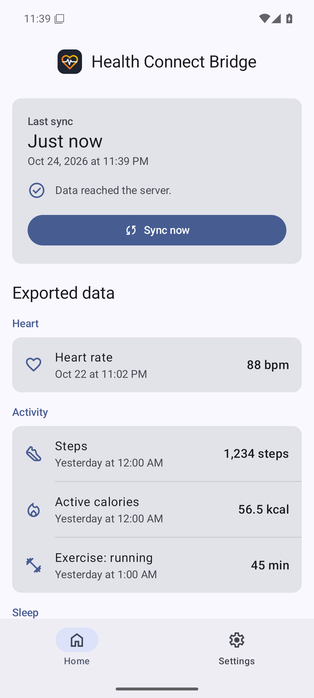
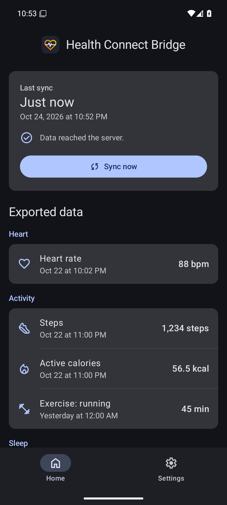
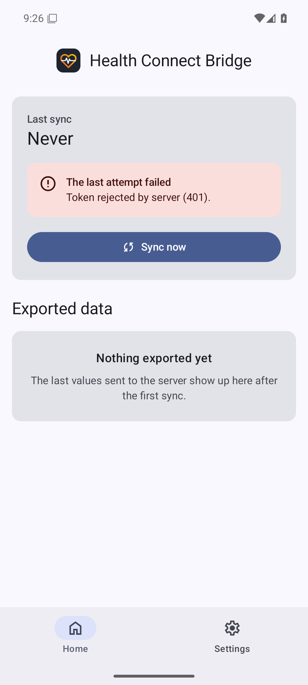
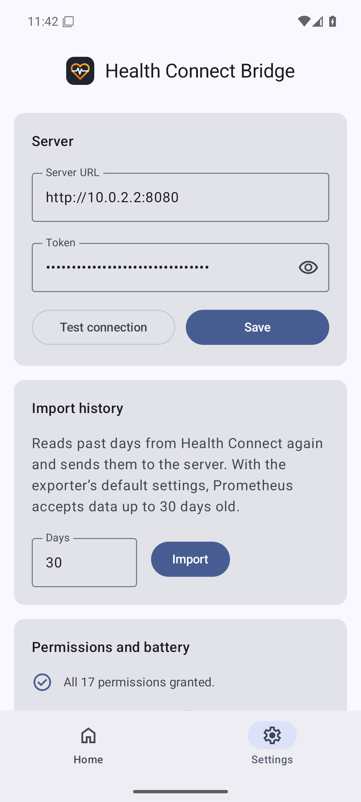
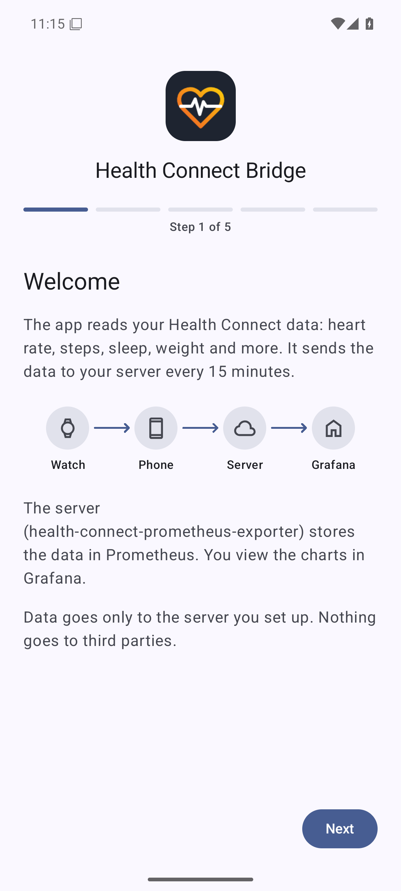
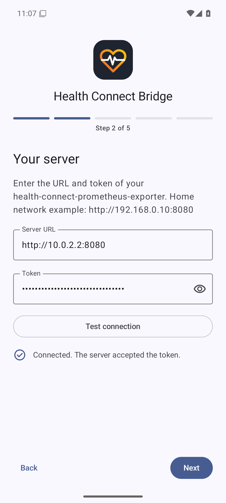
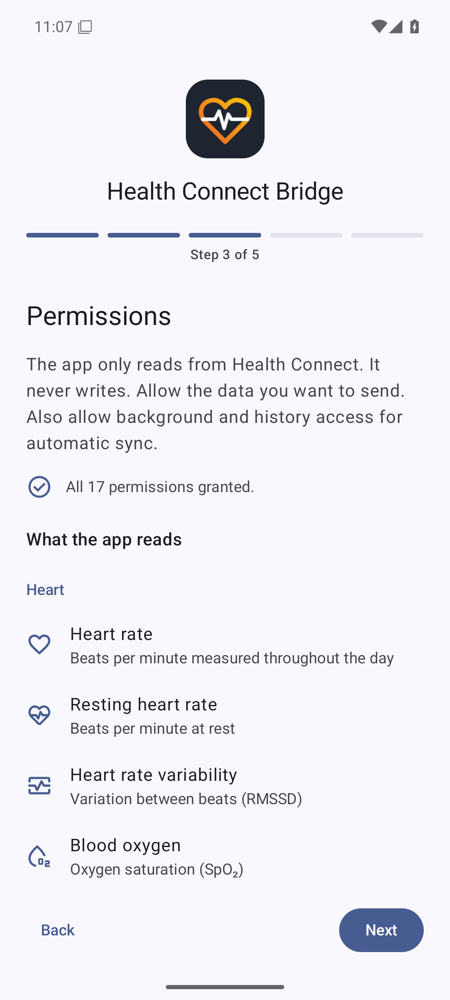
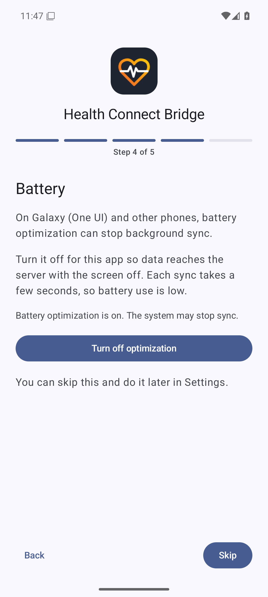
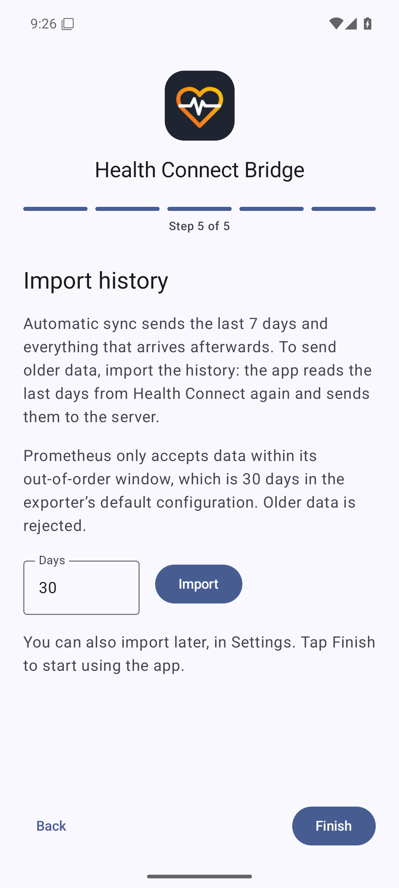
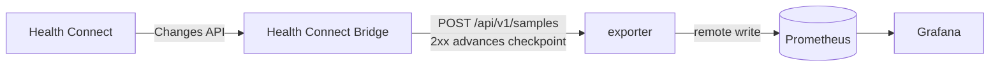

<p align="center"></p>

<h1 align="center">Health Connect Bridge</h1>

Android app that reads your health data from [Health Connect](https://developer.android.com/health-and-fitness/guides/health-connect) in the background and sends it, already mapped to Prometheus metric names, to [health-connect-prometheus-exporter](https://github.com/MateuxLucax/health-connect-prometheus-exporter), which writes it to Prometheus with the original timestamps.

Built for a Galaxy Watch + Samsung Health setup, but it works with any app that writes to Health Connect. Personal, sideloaded app: there is no Play Store listing.

The app is in English and Brazilian Portuguese: it follows the phone's language, and on Android 13+ you can pick it per app in **Settings > System > Languages > App languages**.

## Screenshots

<table>
<tr><th>Home</th><th>Dark theme</th><th>Error</th><th>Settings</th></tr>
<tr><td></td><td></td><td></td><td></td></tr>
</table>

First launch walks through five steps:

<table>
<tr><th>Welcome</th><th>Server</th><th>Permissions</th><th>Battery</th><th>History</th></tr>
<tr><td></td><td></td><td></td><td></td><td></td></tr>
</table>

Taken on an emulator by the integration test (see [Building](#building)) and refreshed on every push to `main`. The same set in Portuguese is in [docs/screenshots/pt-BR](docs/screenshots/pt-BR).

## Architecture

```
Galaxy Watch
  └─> Samsung Health
        └─> Health Connect
              └─> Health Connect Bridge (this app)
                    └─> POST /api/v1/samples
                          └─> health-connect-prometheus-exporter
                                └─> Prometheus (remote write)
```

- A WorkManager job runs every 15 minutes when there is network.
- It uses the Health Connect **Changes API**, so records that arrive late (the watch syncs in batches) or are edited are still sent.
- First run (or when the set of granted data types changes): it takes a changes token, reads the last 7 days, uploads them, then stores the token. If the token expires (Health Connect keeps them about 30 days), it reads the last 30 days and starts over.
- The checkpoint only moves forward after the server accepts a batch (2xx). Server errors (5xx) and network errors are retried later. A rejected token (401) or other 4xx is shown in the app.
- Deleted records are ignored: Prometheus cannot delete samples.
- **Backfill N days** re-reads that range and uploads it without touching the checkpoint.

## Phone setup

1. In Samsung Health: **Settings > Health Connect**, and allow Samsung Health to write the data types you want.
2. Install the APK from [Releases](https://github.com/MateuxLucax/health-connect-bridge/releases) (allow installing from unknown sources).
3. Open the app and follow the setup steps:
   - **Server**: the server URL (for example `http://192.168.0.10:8080`; plain HTTP is allowed for LAN use) and the token. **Test connection** sends an empty batch to check both.
   - **Permissions**: tap **Grant permissions** and allow all data types, plus **access data in the background** and **access past data** (needed to backfill more than 30 days).
   - **Battery**: tap **Turn off battery optimization**. One UI kills background work otherwise.
   - **History**: optionally import older data, then tap **Finish**.
4. **Home** shows the last sync (or the last error), a **Sync now** button and the last value sent for each metric. **Settings** has the server, history import, permissions and battery settings.

## Metrics

Every sample has a `source` label with the package name of the app that wrote the record (for example `com.sec.android.app.shealth`).

| Health Connect record | Metric | Value | Timestamp | Extra labels |
|---|---|---|---|---|
| HeartRateRecord (each sample) | `health_heart_rate_bpm` | beats per minute | sample time | |
| RestingHeartRateRecord | `health_resting_heart_rate_bpm` | beats per minute | time | |
| HeartRateVariabilityRmssdRecord | `health_heart_rate_variability_rmssd_ms` | ms | time | |
| OxygenSaturationRecord | `health_oxygen_saturation_percent` | % | time | |
| RespiratoryRateRecord | `health_respiratory_rate_breaths_per_minute` | breaths/min | time | |
| SkinTemperatureRecord (each delta) | `health_skin_temperature_delta_celsius` | delta in °C | delta time | |
| StepsRecord | `health_steps` | count | start time | |
| DistanceRecord | `health_distance_meters` | meters | start time | |
| ActiveCaloriesBurnedRecord | `health_active_calories_kcal` | kcal | start time | |
| TotalCaloriesBurnedRecord | `health_total_calories_kcal` | kcal | start time | |
| SleepSessionRecord (each stage) | `health_sleep_stage_seconds` | stage duration, s | stage start time | `stage`: awake, sleeping, out_of_bed, light, deep, rem, awake_in_bed, unknown |
| SleepSessionRecord | `health_sleep_session_seconds` | session duration, s | end time | |
| ExerciseSessionRecord | `health_exercise_session_seconds` | session duration, s | start time | `exercise_type`: e.g. `running`, `biking` (the number if unknown) |
| WeightRecord | `health_weight_kg` | kg | time | |
| BodyFatRecord | `health_body_fat_percent` | % | time | |
| Vo2MaxRecord | `health_vo2_max_ml_per_kg_min` | ml/kg/min | time | |

Interval records (steps, distance, calories) are the amount in that interval, stamped at the interval start. The phone does not aggregate; see the exporter's README for how to query them.

Skin temperature is skipped on devices whose Health Connect version doesn't support it.

Edited records keep their old value in Prometheus: a sample is identified by its timestamp (interval and session start, or the sleep session's end) and labels, so the edited value arrives at the same timestamp and Prometheus rejects it as a duplicate.

## Server API

```
POST {serverUrl}/api/v1/samples
Authorization: Bearer <token>
Content-Type: application/json

{"samples":[{"metric":"health_heart_rate_bpm","labels":{"source":"com.sec.android.app.shealth"},"value":72,"timestamp_ms":1792839600000}]}
```

At most 5,000 samples per request.

## Building

GitHub Actions builds a release APK on every push to `main` (downloadable as a workflow artifact). Pushing a tag like `v1.0.0` also publishes `health-connect-bridge-1.0.0.apk` to a GitHub Release. The version name comes from the tag and the version code from the run number.

The **Integration** workflow runs an end-to-end test on an Android emulator: it inserts records into the real Health Connect, runs the app's sync against [health-connect-prometheus-exporter](https://github.com/MateuxLucax/health-connect-prometheus-exporter) and a real Prometheus, and checks every sample in Prometheus against the [Metrics](#metrics) table (including late records through the Changes API and a rejected token). It also takes the screenshots above.

Locally: `./gradlew assembleRelease` (JDK 17 and the Android SDK are required).

### Release signing

Tagged releases require the four signing secrets below: the Build workflow fails on a `v*` tag without them. Builds of `main` and manual runs without secrets fall back to a throwaway debug key, which changes between builds, so you would have to uninstall before each update. Every build prints the APK's signer certificate SHA-256 in the job summary, and releases append it to the release notes, so you can check it with `apksigner verify --print-certs` before installing.

Create a keystore once:

```sh
keytool -genkeypair -v -keystore release.jks -alias release \
  -keyalg RSA -keysize 4096 -validity 10000
base64 -w0 release.jks > release.jks.base64
```

Then add these repository secrets (**Settings > Secrets and variables > Actions**):

| Secret | Value |
|---|---|
| `SIGNING_KEYSTORE_BASE64` | contents of `release.jks.base64` |
| `SIGNING_STORE_PASSWORD` | keystore password |
| `SIGNING_KEY_ALIAS` | `release` (the alias above) |
| `SIGNING_KEY_PASSWORD` | key password |

Keep `release.jks` somewhere safe and never commit it.

## Documentation



- [Architecture](docs/architecture.md): system context, components, deployment, trust boundaries
- [Sequences](docs/sequences.md): onboarding, sync, errors, backfill, end to end
- [Data](docs/data.md): API contract, metric catalog, on-device state
- [Decision records](docs/adr/README.md)
- Server side: [exporter docs](https://github.com/MateuxLucax/health-connect-prometheus-exporter/tree/main/docs)

## License

[MIT](LICENSE)
