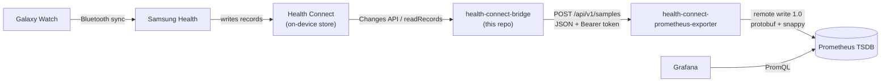
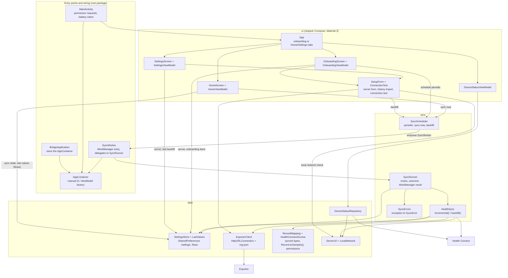
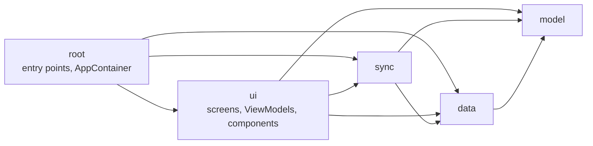
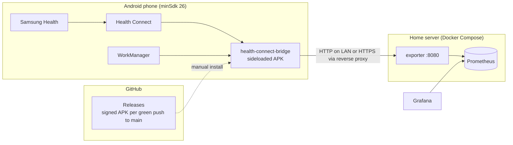
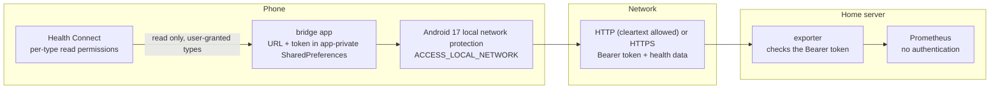

# Architecture

## System context

Health data travels from the watch to Grafana through two projects: this app
and [health-connect-prometheus-exporter](https://github.com/MateuxLucax/health-connect-prometheus-exporter)
(Go server).

- The watch syncs to the phone late and in batches, so records reach Health
  Connect minutes or hours after they were measured. Any other app that
  writes to Health Connect works the same way.
- The app only reads Health Connect. It maps records to Prometheus samples
  (metric name, labels, value, original timestamp) and owns the sync
  checkpoint (the Health Connect changes token).
- The exporter validates the samples and writes them to Prometheus with their
  original timestamps. It holds no state.

## Components

## Code structure

One Gradle module; packages by layer, features inside `ui/`
([ADR 0013](adr/0013-code-structure.md)). Paths are relative to
`app/src/main/java/io/github/mateuxlucax/healthconnectbridge/`.

| Package | Files | Responsibility |
|---------|-------|----------------|
| (root) | `MainActivity.kt` | Launcher activity: schedules the periodic job when onboarding is done; launches the Health Connect permission request, the local network permission request (Android 17+) and the battery-optimization exemption; reloads the device status on resume |
| | `PrivacyActivity.kt` | Privacy rationale opened from the Health Connect permission screen |
| | `SyncWorker.kt` | WorkManager worker for the periodic, sync-now and backfill jobs; delegates to `SyncRunner` |
| | `BridgeApplication.kt`, `AppContainer.kt` | Manual dependency injection: one container with the stores, clients, scheduler and the ViewModel factory |
| `model` | `Sample.kt`, `SyncError.kt`, `SyncState.kt`, `BackfillResult.kt`, `LastValue.kt`, `DeviceStatus.kt` | Plain entities. `SyncError.Kind` has a `retry` flag; its text is in `ui/format` |
| `data/local` | `SettingsStore.kt`, `LastValues.kt`, `PreferenceChanges.kt` | Persisted state (one SharedPreferences file) and flows of its changes |
| `data/exporter` | `ExporterClient.kt` | `POST {serverUrl}/api/v1/samples` in chunks of 5,000 |
| `data/healthconnect` | `RecordMapping.kt`, `HealthConnectAccess.kt` | The synced record types with their metrics, the record-to-sample mapping; the client, supported types and requested permissions |
| `data/network` | `ServerUrl.kt`, `LocalNetwork.kt` | URL validation, cleartext warning, private ranges; whether the server is on the local network and whether access is granted (Android 17+) |
| `data` | `DeviceStatusRepository.kt` | Health Connect availability, granted vs. requested permissions, battery exemption, local network access when the server is local |
| `sync` | `HealthSync.kt` | Changes API sync, initial reads, backfill; skips records Health Connect can't read ([ADR 0014](adr/0014-skip-unreadable-records.md)) |
| | `SyncRunner.kt`, `SyncErrors.kt` | One run at a time; records the outcome and returns success, failure or retry; maps exceptions to `SyncError` kinds (shared with the connection test) |
| | `SyncScheduler.kt` | Unique work: `periodic-sync`, `sync-now`, `backfill` |
| `ui` | `App.kt`, `AppActions.kt`, `DeviceStatusViewModel.kt`, `WhileUiSubscribed.kt` | Onboarding until finished, then the Home and Settings tabs; activity callbacks passed to the screens; the device status, reloaded on resume |
| `ui/onboarding` | `OnboardingScreen.kt`, `OnboardingViewModel.kt`, `DataFlow.kt` | Welcome (with the data flow animation), server (URL, token, connection test), permissions, battery, history import |
| `ui/home` | `HomeScreen.kt`, `HomeViewModel.kt` | Last success or last error, "sync now", last value per metric |
| `ui/settings` | `SettingsScreen.kt`, `SettingsViewModel.kt` | Server settings and connection test, history import, permission and battery state |
| `ui/components` | `Components.kt`, `ServerSection.kt`, `StatusSection.kt`, `SetupForm.kt`, `ConnectionTest.kt`, `DataTypeCatalog.kt` | Shared composables; the server form, history import and connection test shared by the onboarding and Settings ViewModels; data types as shown to the user |
| `ui/format` | `Strings.kt`, `Format.kt`, `SyncErrorText.kt` | String resource lookup, locale-aware formatting, error messages |
| `ui/theme` | `Theme.kt` | Dynamic color theme |
| `res` | `values`, `values-pt-rBR` | UI text in English (default) and Brazilian Portuguese |

Dependency rules (checked by `LayerDependencyTest`):

| Package | May import | Must not import |
|---------|------------|-----------------|
| `model` | Kotlin, Java, Health Connect constants | anything else in the app, `Context`, `R` |
| `data` | `model`, other `data` packages, Android and Health Connect APIs | `sync`, `ui`, `R` |
| `sync` | `data`, `model`, WorkManager | `ui`, `R` |
| `ui` | `sync` (`SyncErrors`), `data`, `model`, `R`, `BuildConfig` | the rest of the root package: activity callbacks arrive as `AppActions`, dependencies through the ViewModel factory |
| root | everything | (no layer imports or names it) |

Screens get their data through their ViewModel (the device status through
`DeviceStatusViewModel`); composables in `ui/components` use only pure
helpers such as `ServerUrl.isValid`, and get the local network check from
`SetupForm`. `SyncWorker`, `MainActivity` and `PrivacyActivity`
never move or change name: WorkManager and the manifest refer to them.

## Deployment

- The Build workflow builds the signed APK, runs the unit tests and the
  emulator end-to-end test on every push to `main`; when all pass, the same
  run publishes it as GitHub Release `v<VERSION>.<run number>` (see
  [ADR 0012](adr/0012-automatic-releases.md)). Manually pushed `v*` tags are
  released the same way. There is no Play Store listing.
- The server side (exporter image, compose file, Prometheus config) is in the
  exporter repo.

## Trust boundaries

| Boundary | Control |
|----------|---------|
| Health Connect to app | The user grants read permission per record type, plus background and history access. The app requests no write permissions in release builds (the debug manifest adds a few write permissions for the emulator test only). |
| App storage | Server URL, token and sync state are in app-private SharedPreferences (`MODE_PRIVATE`). |
| App to exporter | Every request carries `Authorization: Bearer <token>`; the exporter checks it before reading the body and answers `401` otherwise. |
| App to local network | On Android 17+ (the app targets SDK 37) connections to local addresses need the runtime permission `ACCESS_LOCAL_NETWORK` (Nearby devices group); without it they time out. The app declares it and asks only when the server resolves to a local address. The background sync can't ask: it fails with `LOCAL_NETWORK_PERMISSION` instead. See [ADR 0011](adr/0011-local-network-permission.md). |
| Transport | `usesCleartextTraffic="true"` allows plain HTTP for LAN use. Outside a trusted LAN, the exporter must be behind an HTTPS reverse proxy; the app then uses an `https://` URL. |
| Data destination | Data goes only to the configured server. No analytics or third-party SDKs. |
