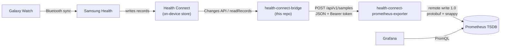
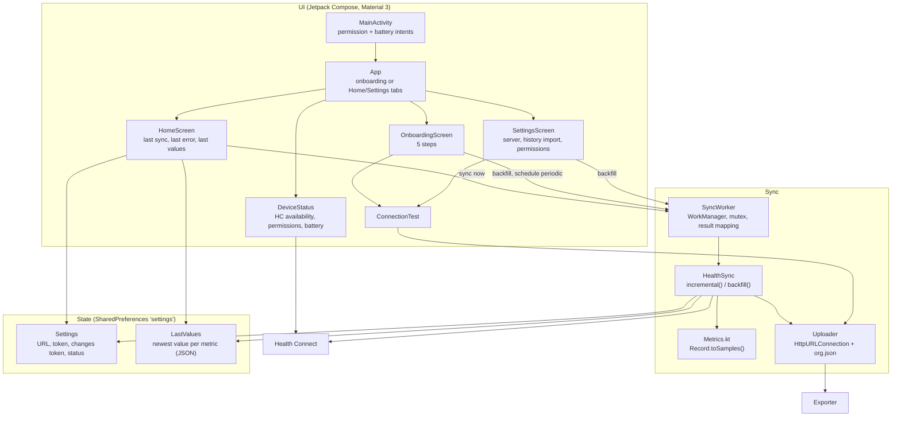
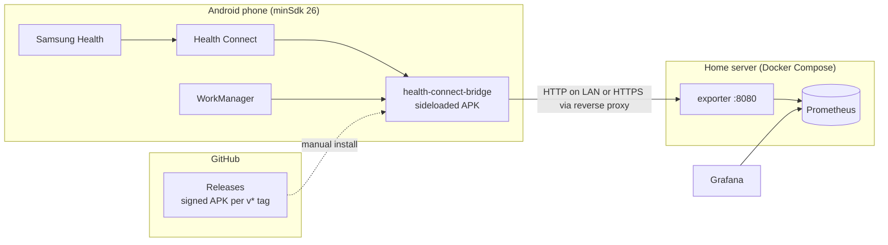
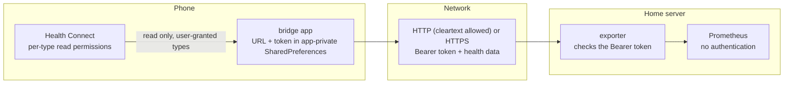

# Architecture

## System context

Health data travels from the watch to Grafana through two projects: this app
and [health-connect-prometheus-exporter](https://github.com/MateuxLucax/health-connect-prometheus-exporter)
(Go server).

- The watch syncs to the phone late and in batches, so records reach Health
  Connect minutes or hours after they were measured. Any other app that
  writes to Health Connect works the same way.
- The app only reads Health Connect. It maps records to Prometheus samples
  (metric name, labels, value, original timestamp) and owns the sync
  checkpoint (the Health Connect changes token).
- The exporter validates the samples and writes them to Prometheus with their
  original timestamps. It holds no state.

## Components

| File | Responsibility |
|------|----------------|
| `MainActivity.kt` | Entry point; schedules the periodic job when onboarding is done; launches the Health Connect permission request and the battery-optimization exemption; refreshes screens on resume and on preference changes |
| `App.kt` | Shows onboarding until it is finished, then the Home and Settings tabs |
| `OnboardingScreen.kt` | Welcome, server (URL, token, connection test), permissions, battery, history import |
| `HomeScreen.kt` | Last success or last error, "sync now", last value per metric |
| `SettingsScreen.kt` | Server settings and connection test, history import, permission and battery state |
| `ConnectionTest.kt` | Sends an empty batch and reports the outcome |
| `DeviceStatus.kt` | Health Connect availability, granted vs. requested permissions, battery exemption |
| `SyncWorker.kt` | WorkManager worker: periodic, sync-now and backfill jobs; maps exceptions to success, failure or retry |
| `HealthSync.kt` | Changes API sync, initial reads, backfill, readable types and requested permissions |
| `Metrics.kt` | Synced record types and the record-to-sample mapping |
| `Uploader.kt` | `POST {serverUrl}/api/v1/samples` in chunks of 5,000 |
| `Settings.kt`, `LastValues.kt` | Persisted state |
| `Catalog.kt`, `Format.kt`, `Components.kt`, `Theme.kt` | Data type list for the UI, value formatting, shared composables, dynamic color theme |
| `PrivacyActivity.kt` | Privacy rationale opened from the Health Connect permission screen |

## Deployment

- The APK is built by the Build workflow on every push to `main` (workflow
  artifact) and attached to a GitHub Release for `v*` tags. There is no Play
  Store listing.
- The server side (exporter image, compose file, Prometheus config) is in the
  exporter repo.

## Trust boundaries

| Boundary | Control |
|----------|---------|
| Health Connect to app | The user grants read permission per record type, plus background and history access. The app requests no write permissions in release builds (the debug manifest adds a few write permissions for the emulator test only). |
| App storage | Server URL, token and sync state are in app-private SharedPreferences (`MODE_PRIVATE`). |
| App to exporter | Every request carries `Authorization: Bearer <token>`; the exporter checks it before reading the body and answers `401` otherwise. |
| Transport | `usesCleartextTraffic="true"` allows plain HTTP for LAN use. Outside a trusted LAN, the exporter must be behind an HTTPS reverse proxy; the app then uses an `https://` URL. |
| Data destination | Data goes only to the configured server. No analytics or third-party SDKs. |
