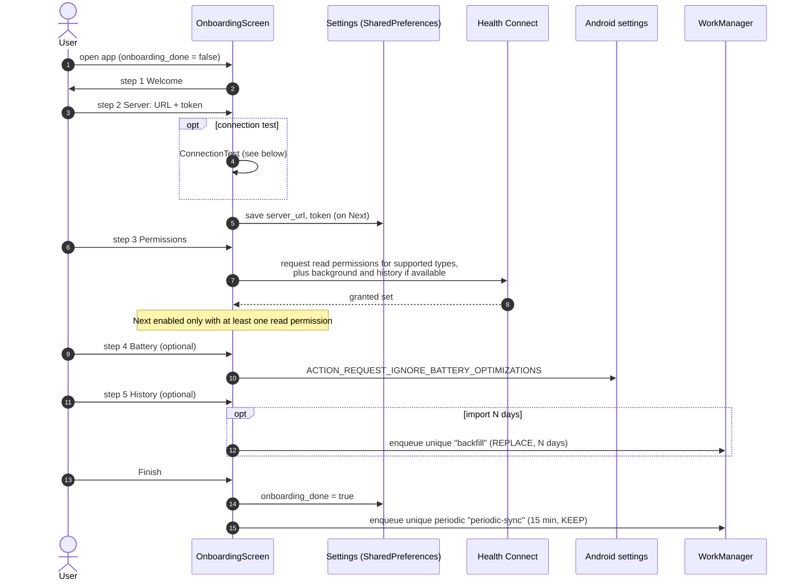
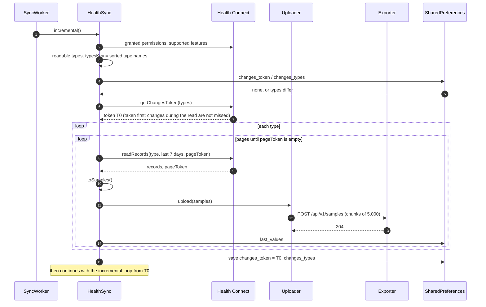
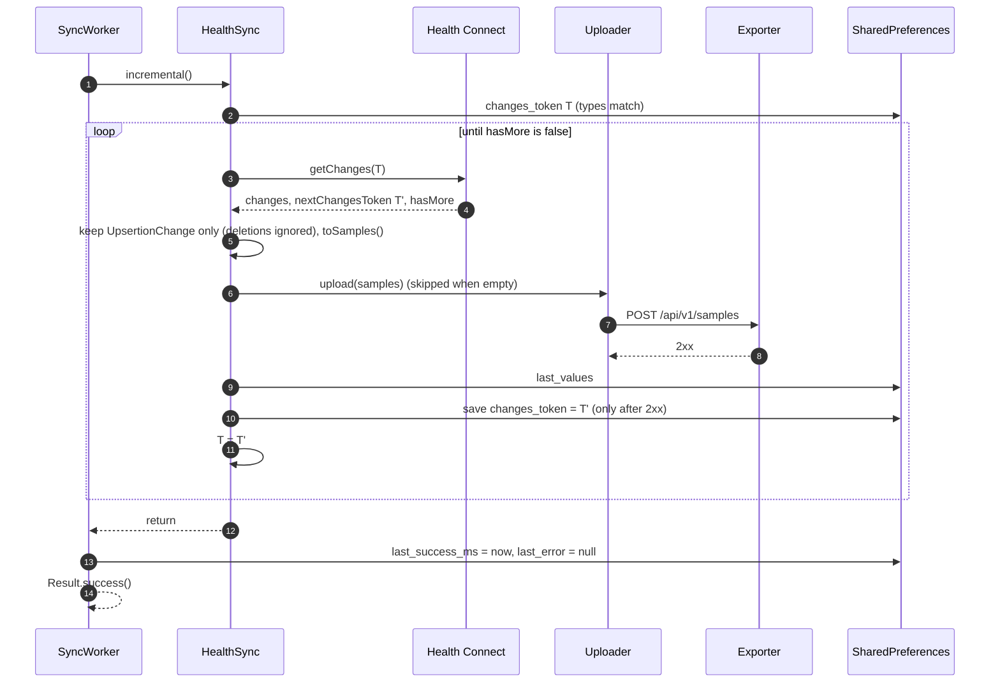
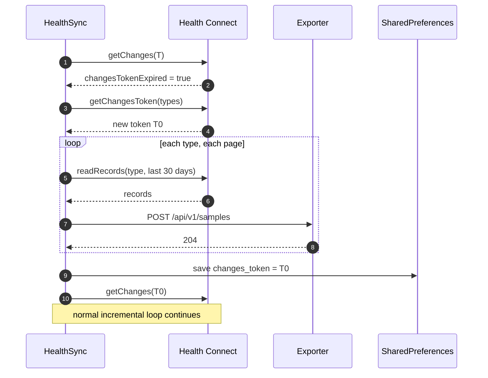
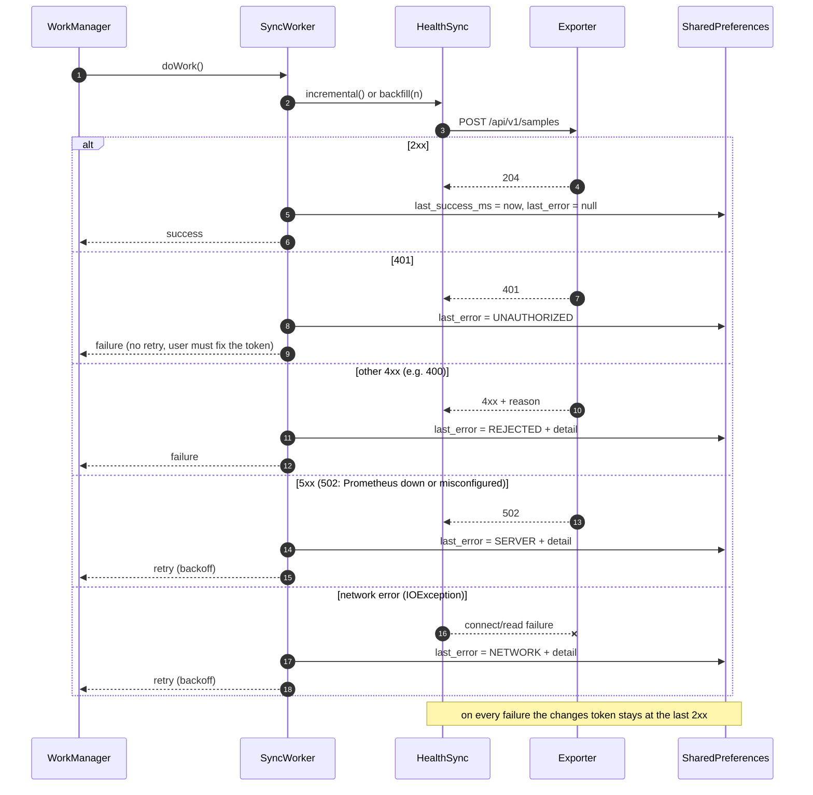
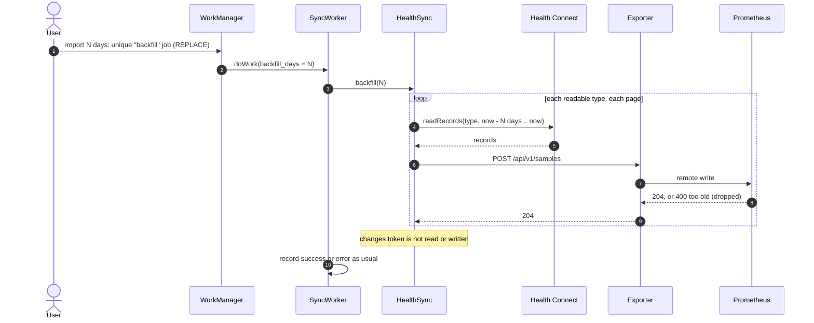
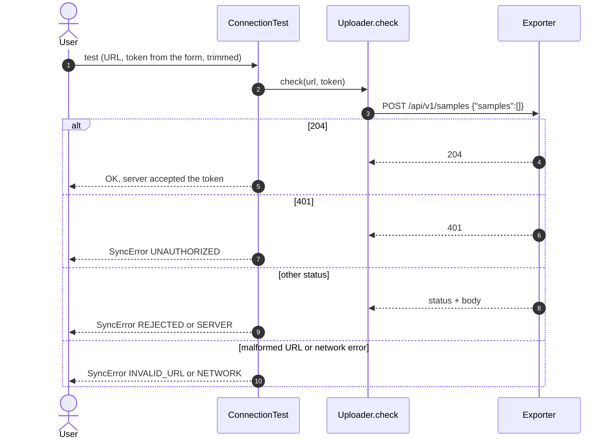
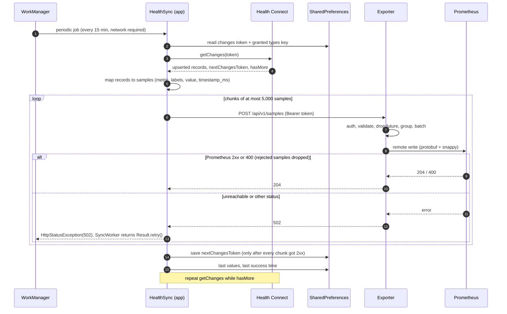

# Sequences

- [Onboarding](#onboarding)
- [First sync](#first-sync)
- [Incremental sync](#incremental-sync)
- [Changes token expired](#changes-token-expired)
- [Error handling](#error-handling)
- [Backfill (history import)](#backfill-history-import)
- [Connection test](#connection-test)
- [End to end: app, exporter, Prometheus](#end-to-end-app-exporter-prometheus)

All sync work runs in `SyncWorker` (WorkManager, network required). A
process-wide mutex makes jobs run one at a time.

## Onboarding

`MainActivity` also calls `schedulePeriodic` on every launch after
onboarding; `KEEP` leaves an existing schedule alone.

## First sync

No changes token is stored yet, or the set of readable record types changed
(the stored `changes_types` differs).

If any upload fails, the exception propagates before `T0` is saved, so the
next run starts the initial read again.

## Incremental sync

A failure in the middle of the loop keeps the last token saved after a
successful page; the next run resumes from there.

## Changes token expired

Health Connect keeps changes tokens for about 30 days.

Samples already in Prometheus are sent again; Prometheus keeps the stored
value, so the re-read is harmless.

## Error handling

`SyncWorker.runAndReport` turns any exception into a `SyncError` (a stable
kind plus a detail), stores it in `last_error` / `last_error_detail` for the
Home screen, and returns `retry` when the kind's `retry` flag is set,
otherwise `failure`.

Other outcomes: missing URL or token, Health Connect unavailable, no read
permission (`SetupException`), a malformed URL and `SecurityException` end
with `failure`; any other exception (for example Health Connect rate
limiting) ends with `retry`. A `failure` ends that run only; the periodic job runs again at its
next interval.

## Backfill (history import)

Started from onboarding or Settings with a number of days (default 30).

Samples older than Prometheus' out-of-order window (30 days in the exporter's
example config) are rejected by Prometheus and dropped by the exporter; the
request still succeeds.

## Connection test

The empty batch reaches neither Health Connect nor Prometheus, and the form
values are not saved by the test.

## End to end: app, exporter, Prometheus

The same diagram appears in the
[exporter docs](https://github.com/MateuxLucax/health-connect-prometheus-exporter/blob/main/docs/sequences.md#end-to-end-app-exporter-prometheus).

